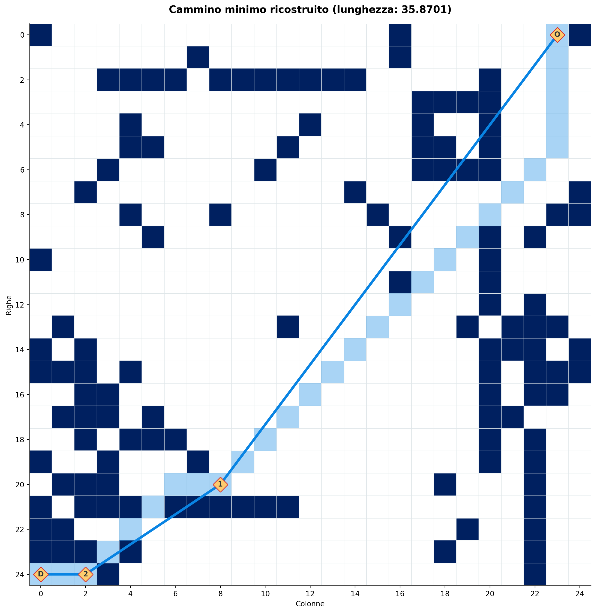
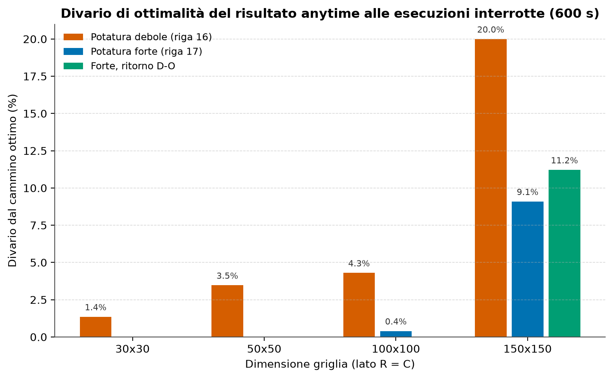

# Cammino minimo su griglia con ricerca ricorsiva a punti di passaggio

[](https://github.com/SickCiQuattro/the-halting-mother/actions/workflows/test.yml)


Ricerca esatta del cammino minimo su una griglia a 8 direzioni con ostacoli, basata su una ricorsione sui *punti di passaggio* (landmark) e potatura branch-and-bound. Progetto del corso di Algoritmi e Strutture Dati (a.a. 2024/25), scritto in Python 3.13 con NumPy e Matplotlib.



## Che cosa fa

- **Genera griglie** con cinque tipi di ostacolo (`simple`, `cluster`, `diagonal`, `enclosure`, `bar`) o una loro miscela.
- **Calcola contesto, complemento e frontiera** di una cella, cioè le regioni raggiungibili in linea retta libera, con proiezione di raggi in $O(\max(R, C)^2)$ invece della scansione diretta $O(R \cdot C \cdot (R + C))$.
- **Trova il cammino minimo** (`CAMMINOMIN`) scegliendo i punti di passaggio dalla frontiera e ricorrendo sui due tratti.
- **Riproduce una campagna sperimentale** completa: scalabilità, densità degli ostacoli, confronto tra potature, ordinamenti, simmetria origine-destinazione e labirinti.

## Come funziona

1. Dalla cella di origine si calcola la **frontiera**: le celle da cui si può passare restando in linea retta libera.
2. Per ogni cella di frontiera, ordinata per distanza ideale crescente, si risolve in modo ricorsivo il tratto restante.
3. La distanza ideale $d_{\text{lib}}$ (distanza ottagonale, senza ostacoli) non sovrastima mai la distanza reale, quindi la **potatura con limite superiore globale** non scarta mai il cammino ottimo. Il limite si aggiorna ogni volta che si trova un cammino completo più breve.
4. Le celle della chiusura corrente vengono marcate come ostacolo temporaneo **sul posto** nella matrice `uint8` e ripristinate nella risalita, senza copiare lo stato.

### Scelte progettuali

- **Nessuna memoizzazione.** È stata provata e scartata: il risultato di un sotto-problema dipende, tramite la potatura globale, dalla lunghezza già accumulata, che la chiave non conteneva. Riusarlo dava cammini non minimi e violava la simmetria tra andata e ritorno.
- **Marcatura costante degli ostacoli temporanei.** Una versione con valore pari alla profondità superava i 255 di `uint8` oltre la profondità 253. Il valore fisso `2` basta perché le chiusure annidate sono disgiunte.
- **Controllo delle componenti connesse** alla radice, in $O(R \cdot C)$: se origine e destinazione sono separate si risponde subito "irraggiungibile" invece di esaurire la frontiera.
- **A\* come oracolo.** `dlib` è un'euristica ammissibile e consistente, quindi A\* dà l'ottimo con cui confrontare ogni risultato di `CAMMINOMIN`.
- **Griglia a bit** (`src/bitgrid.py`): 2 bit per cella, memoria circa quattro volte inferiore e tempo circa doppio rispetto all'array `uint8`.

## Risultati

| Verifica | Esito |
|---|---|
| Correttezza | Ogni cammino completato coincide con l'ottimo calcolato da A\* |
| Simmetria origine-destinazione | 64 coppie verificabili, 0 fallimenti |
| Coppie irraggiungibili | 0,014 s con il controllo delle componenti connesse, contro 600 s di tempo limite senza |
| Test automatici | 46, tutti superati |



> [!NOTE]
> La ricerca è esatta ma di costo esponenziale nel caso peggiore: oltre il lato 50 le esecuzioni possono raggiungere il tempo limite e restituire il miglior cammino trovato fino a quel momento (divario dall'ottimo tra lo 0,4% e il 20% nelle prove a lato 100 e 150).

## Installazione

Servono Python 3.10 o successivo (sviluppato su 3.13) e `pip`.

```bash
python3.13 -m venv .venv         # Windows: py -3.13 -m venv .venv
source .venv/bin/activate        # Windows PowerShell: .venv\Scripts\Activate.ps1
pip install -e .
```

## Uso

Tutti i comandi passano da `main.py` (dopo `pip install -e .` anche dal comando `camminomin`, ad esempio `camminomin dlib --origin 10,10 --dest 40,40`). Per l'elenco completo: `python main.py --help`.

**Generare una griglia** e salvarne l'immagine:

```bash
python main.py generate --types mix --seed 42 --save-img results/griglia.png
```

**Contesto, complemento e frontiera** di una cella:

```bash
python main.py context --grid grids/grid.json --origin 10,10 --save-img results/contesto.png
```

**Distanza ideale** tra due celle:

```bash
python main.py dlib --origin 10,10 --dest 40,40
```

**Cammino minimo** con potatura forte e riepilogo in JSON:

```bash
python main.py camminomin --grid grids/grid.json --origin 0,0 --dest 49,49 \
  --strong-pruning --summary --save-img results/cammino.png
```

**Campagna sperimentale** (circa 2 ore) e verifica di simmetria su coppie casuali:

```bash
python main.py experiment --output-dir results
python main.py experiment --verify-symmetry-count 10
```

## Test

```bash
python -m unittest discover -s tests -p "test_*.py"
```

## Struttura del repository

| Percorso | Contenuto |
|---|---|
| `src/` | Algoritmi, generatore di griglie, visualizzazione ed esperimenti |
| `tests/` | Test unitari |
| `scripts/` | Script che riproducono singole figure e verifiche |
| `results/` | Dati e grafici della campagna sperimentale |
| `demo/` | Griglie e immagini di esempio |
